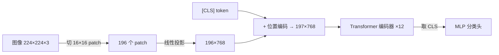

# 卡片盒规格

## 写卡片盒：`obsidian_write_paper_board`

| 参数 | 说明 |
|---|---|
| `path` | `Papers/<KEY>/<KEY> 卡片盒.excalidraw.md` |
| `board` | board JSON 字符串（见下） |
| `back` | Markdown 面开头的文献笔记（5C、一段话总结、精读清单、阅读路线）。工具会在后面接 `## 卡片` 和每张卡的一节 |
| `properties` | frontmatter JSON（见下） |
| `theme` | 配色，默认 `fresh` |
| `font` | `sans`（默认）/ `hand` / `local` |
| `overwrite` | 重新生成时设为 true；省略 `back`/`properties` 时保留原值 |

```json
{"key":"VIT","title":"ViT：An Image is Worth 16x16 Words","series":"ViT · ICLR 2021",
 "outline":"ViT 精读\n  问题\n    @VIT-Q01\n  方法\n    @VIT-M01\n    @VIT-M02\n  结果\n    @VIT-R01\n  批判与启发\n    @VIT-K01\n    [[Zettel/Patch Embedding.excalidraw.md|永久卡 · Patch Embedding]]",
 "cards":[ … ],
 "growthMode":"Right-Left","cardScale":0.6}
```

- `outline`：缩进大纲，第一行是根节点。`@<卡片ID>` 放置一张卡（每张最多一次，没放的会归到"其他"分支）。普通行是文字节点，`[[笔记|别名]]` 是链接节点。
- 一级分支固定为：问题 / 方法 / 实验 / 结果 / 批判与启发（没有内容的分支省略）。
- `growthMode` 默认 `Right-Left`（左右平衡，全图更紧凑）；`cardScale` 是卡片在导图里的缩放，默认 0.6。
- 卡片在 Slideshow 里的顺序 = 大纲里出现的顺序，第 0 帧是全图概览。

## 卡片（`cards[]` 的一项）

| 字段 | 说明 |
|---|---|
| `id` | `<KEY>-<类型字母><两位序号>`，如 `VIT-M02`。类型字母决定颜色和标签 |
| `title` | 断言句，≤ 22 个汉字 |
| `type` | 可省略，默认取 id 里的字母：Q 问题 · C 概念 · M 方法 · D 推导 · E 实验设置 · R 结果 · A 消融 · K 批判 · I 启发 · Z 永久卡 |
| `subtitle` | 可选，一句话上下文 |
| `visual` | 一个图形，或两个图形组成的数组（工具会自动选择并排或上下排列）。**每张卡都要有** |
| `points` | ≤ 5 条要点，`"文字"` 或 `{n, text}`。`n` 与图上的 `marks`/`boxes` 编号相同时，编号圈会变成红色，表示两者对应 |
| `takeaway` | 一句结论，显示在右下角 |
| `source` | 页脚出处，如 `Fig.3 · §4.3` |
| `notes` | Slideshow 演讲者备注 |
| `back` | 这张卡的背面 Markdown（模板见下），出现在 Markdown 面该卡的那一节 |

### 图形（visual）

先选图形再写字。按要表达的内容选：

| 想表达 | kind | 写法 |
|---|---|---|
| 论文原图/表 + 解读 | `figure` | `{kind:"figure", path:"Papers/VIT/assets/fig3.png", boxes:[{n:1,x:.15,y:.18,w:.12,h:.4}], marks:[{n:2,x:.9,y:.05}], caption?}`，坐标是图片宽高的 0..1 比例 |
| 张量形状变化 | `tensor` | `{kind:"tensor", steps:[{label:"B×224×224×3",dims:[224,224,3]},{label:"B×196×768",dims:[196,768],op:"reshape + Linear"}]}` |
| 注意力/相似度矩阵 | `matrix` | `{kind:"matrix", title, pattern:"causal"\|"diagonal"\|"local"\|"full", size:6}`，或用论文里的真实数值 `{rows, cols, values, showValues:true}` |
| 模块堆叠 / 残差 | `stack` | `{kind:"stack", title, input, output, repeat:"×L", layers:[{label:"LayerNorm",kind:"norm"},{label:"MHA",kind:"attn"},{label:"+",kind:"add"}], residual:[[0,2]]}`，layers 从下往上写；kind 取 norm/attn/mlp/add/embed/head/other |
| 切 patch / token 化 | `patches` | `{kind:"patches", rows:4, cols:4, cls:true, label:"N = HW/P² 个 token"}` |
| 数值对比 | `bars` | `{kind:"bars", title, unit:"%", items:[{label:"ViT-H/14",value:88.55,hl:true}]}`，只用论文里的数字 |
| 对比/流程/时间线/四象限… | `template` | `{kind:"template", template:"compare", spec:{…}}`，spec 与 `obsidian_write_template` 相同（`obsidian_template_help` 查格式） |
| 以上都不合适 | `sketch` | `{kind:"sketch", elements:[…]}`，手绘元素，见 [sketching.md](sketching.md) |

用 `figure` 解读原图的步骤：

1. 用 Read 看截图，找出要读者看的 2–4 个位置（某条曲线、阴影区、某一列数字、模型图里的某个模块）。
2. 估计这些位置的比例坐标：`x`、`y` 是左上角，`w`、`h` 是宽高，都是相对整张图的 0..1。`boxes` 画红色虚线框，并在框的左上角放编号圈；`marks` 只放编号圈。
3. `points` 用同样的编号写"看哪里 → 看出什么"。
4. 导出 PNG 检查编号圈位置，不准就调整坐标后重新生成。

搭配建议：

- 一张卡**最多放一张论文原图**。原图卡可以再配一个小的 `bars`，例如把表里的关键数字单独画出来。
- 方法卡：`patches`、`tensor`、`stack` 两两组合最直观。
- 表格（`tab<N>.png`）通常太密，优先只把相关的几个数字画成 `bars` 或 `matrix`（`showValues`），原表放背面：`![[Papers/VIT/assets/tab2.png]]`。

### 背面（`back`）模板

```markdown
> [!abstract] 一句话
> 用一句话（≤ 40 字）讲清这张卡的观点。

**解释**：用自己的话展开 3–6 句。行首用 **事实** / **推导** / **理解** 标明认知层级。

> [!quote] §3.1, Eq.(1), p.3
> "原文片段（≤ 3 句）"

（Mermaid 或原表 `![[Papers/VIT/assets/tab2.png]]`）

- [ ] 疑问：…
- 链接：上游 [[#VIT-Q01 CNN 的归纳偏置是视觉必需品吗？]] · 依赖 [[Zettel/Self-Attention.excalidraw.md|Self-Attention]] · 对比 [[Papers/DEIT/DEIT 卡片盒.excalidraw|DeiT]]
```

- 每张卡这一节的标题由工具生成：`### <ID> <标题>`（会去掉 `# | [ ] ^ : \`）。同一文件内用 `[[#<ID> <标题>]]` 链接到它。
- **不要**在 `back` 里写 `#`/`##`/`###` 标题（会打乱各节结构），用粗体或 callout 代替。
- 不能出现以下标题行：`# Excalidraw Data`、`## Text Elements`、`## Element Links`、`## Embedded Files`、`## Drawing`，工具会拒绝写入。

## `properties`

```json
{"tags":["paper","field/cv"],"key":"VIT","title":"An Image is Worth 16x16 Words","year":2021,"venue":"ICLR 2021",
 "arxiv":"2010.11929","status":"pass2","read":"2026-10-20","cards":12}
```

- `status`：pass1 / pass2 / pass3 / done
- 永久卡（`obsidian_write_card`）：`{"tags":["zettel/permanent"],"card_id":"Z-RoPE","paper":["[[VIT]]","[[LLAMA3]]"]}`

## 文献笔记（`back` 参数）

```markdown
# ViT：把图像切成 16×16 patch 直接喂 Transformer

## 5C
- **类别**：… · **背景**：… · **可信度**：… · **贡献**：…（§x）/ 我的判断：… · **清晰度**：…

## 一段话总结（自己的话）

## 精读清单
- [x] 骨干：…（[[#VIT-M02 …]]）
- [ ] 未说明：…

## 阅读路线
Q01 → M01 → M02 → R01 → K01

## 待追的引文
- [ ] …
```

## 领域地图

`Index/<领域> 地图.excalidraw.md`，用 `obsidian_write_mindmap` 写：根节点是领域，一级是子方向，二级用 `[[Papers/<KEY>/<KEY> 卡片盒.excalidraw|KEY 简称]]` 链接各论文，或链接永久卡。

## Mermaid

只写在背面。规则：

- 节点文字含有 `()[]{}:;"` 或公式时**必须加引号**：`A["softmax(QKᵀ/√d)"]`
- 公式里用 Unicode（ᵀ √ × ·），Mermaid 标签中不要写 `$…$`
- 节点数 ≤ 12；方向用 `flowchart LR`（数据流）或 `TD`（层级）

| 场景 | 图型 |
|---|---|
| 模型数据流、张量形状变化 | `flowchart LR`，在边上标形状：`A -->|"B×N×D"| B` |
| 多阶段训练流程 | `flowchart LR` 加 `subgraph` 分阶段 |
| 推理时的交互（检索、工具、Agent） | `sequenceDiagram` |
| 方法谱系 / 相关工作 | `flowchart TD` 或 `timeline` |
| 消融结果 / 数据配比 | `xychart-beta` 或 `pie`（只用论文里的数字） |


